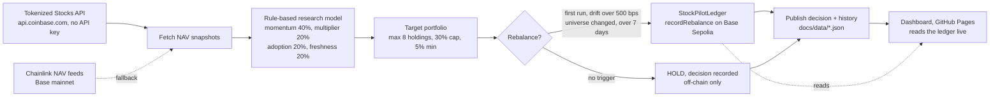

# StockPilot

**Research-to-portfolio agent for Coinbase tokenized stocks on Base.**
Built for the [Base Stocks Maxxing Builder Quest](https://base.org/stocksmaxxing)
(Coinbase/Base), **Agentic Stock Finance** track (Base prize pool $20,000).

StockPilot is an autonomous agent that researches Coinbase-issued tokenized
stocks, builds a target paper portfolio from a transparent rule-based model,
and records every rebalance decision on-chain — with the reasoning hashed and
anchored in a smart contract on Base Sepolia.

> **Simulation only — not investment advice.** StockPilot runs a *paper*
> portfolio. It holds no real funds, buys or sells nothing, and never enables
> trading for anyone. NAV values are Chainlink reference values, not live
> bid/ask prices. Nothing here is investment, legal, or tax advice.

## How it works



**Data integrity rules the agent follows:**

- Only real data is used: the Tokenized Stocks API (read-only, no key) with
  an on-chain Chainlink fallback. The API lists 358 tokens, but only the
  ~12 with a fresh Chainlink NAV enter the universe; the rest are excluded
  with a recorded reason. **No price is ever invented** — if both sources
  fail, the agent stops with an error.
- NAV staleness is enforced: tokens whose NAV is older than 7 days are
  excluded (feeds run 24/5 and hold Friday's close over the weekend).
- Momentum comes from the agent's own local price history (one snapshot per
  day). Until at least two snapshots ≥ 24h apart exist, the momentum
  component is neutral (50) and the rationale says so.

## Research model

Every investable token scores 0–100:

```
total = 0.40*momentum + 0.20*multiplier + 0.20*adoption + 0.20*freshness
```

1. **Momentum (40%)** — NAV change vs the earliest snapshot in the local
   price history: `clamp(50 + return * 500, 0, 100)`, so +10% scores 100
   and −10% scores 0. Neutral (50) until 2 snapshots ≥ 24h apart exist.
2. **Dividend / multiplier accrual (20%)** — Coinbase reinvests
   distributions by raising the token's `multiplier` (shares per token)
   above 1.0: `clamp(50 + min(50, (multiplier − 1) * 5000), 0, 100)`.
   Multiplier 1.0 → 50; 1.01 → 100.
3. **Adoption (20%)** — rank of `log10(total_supply)` within the universe,
   min-max scaled to 0–100. No supply data → neutral 50.
4. **Data freshness (20%)** — 100 if the NAV is under 24h old, declining
   linearly to 0 at the 7-day staleness limit.

**Portfolio construction:** top 8 tokens by score; weights proportional to
score, capped at 30% per holding (excess redistributed iteratively),
minimum 5% per holding, normalized to exactly 10000 bps.

**Rebalance triggers** (any one fires a rebalance): first run (no prior
on-chain record); **drift > 500 bps** (max absolute per-symbol weight
difference vs the on-chain target); universe changed (target holdings
differ from on-chain); **> 7 days** since the last on-chain rebalance.
Full detail, formulas, and edge cases: [agent/README.md](agent/README.md).

## Repo layout

| Path | What it is |
| --- | --- |
| `agent/` | Python agent: API client, research model, portfolio builder, on-chain submitter, CLI, pytest suite (41 tests). Each run publishes `docs/data/latest-decision.json` and `docs/data/history.json` for the dashboard |
| `contracts/` | Foundry project: `StockPilotLedger.sol`, 11 tests, deploy script |
| `docs/` | Static dashboard (GitHub Pages): reads the ledger live via Base Sepolia RPC; `tests/verify_dashboard.py` verifies the site with Playwright |
| `LICENSE` | Apache-2.0 |

## Quickstart

### Agent (dry run — no transaction)

```bash
cd agent
python3 -m venv ../../.venv                          # once; venv lives OUTSIDE the repo
../../.venv/bin/pip install -r requirements.txt
../../.venv/bin/python -m stockpilot.run --dry-run   # full pipeline, no transaction
../../.venv/bin/python -m pytest -q                  # 41 tests
```

The run writes a decision JSON to `agent/data/decisions/`, appends the
day's NAV snapshots to `agent/data/price-history.jsonl`, and publishes
`docs/data/latest-decision.json` + `docs/data/history.json` for the
dashboard. See [agent/README.md](agent/README.md) for the research model,
rebalance policy, and live-run instructions.

### Contracts

```bash
cd contracts
forge install foundry-rs/forge-std   # first time on a fresh clone
forge test                            # 11 tests
```

### Dashboard

```bash
cd docs
python3 -m http.server 8000
# open http://localhost:8000
```

Live dashboard: <https://andipangeranm142.github.io/stockpilot/>
(served from `docs/` via GitHub Pages). Verify it end to end with
Playwright (checks every displayed number against the on-chain record,
the decision files, and `history.json`) — run from the repo root:

```bash
../.venv/bin/python docs/tests/verify_dashboard.py          # local copy
../.venv/bin/python docs/tests/verify_dashboard.py --live   # live site
```

## Deployment status

| Item | Status |
| --- | --- |
| `StockPilotLedger` on Base Sepolia | **Live** — [0x13612a2571C091625db489458298a31c507F54a1](https://sepolia.basescan.org/address/0x13612a2571C091625db489458298a31c507F54a1) |
| Deployer / agent wallet (testnet only) | `0xde897528DEC3E6de4CF52616F7b88c72FA8403eC` |
| Deploy tx | [0x6982044f…99662ad](https://sepolia.basescan.org/tx/0x6982044f4795ea3bda3267c1e2b68780d9cf989c5922c130829c0af7c99662ad) |
| Contract address | `0x13612a2571C091625db489458298a31c507F54a1` (recorded in `agent/contract-address.txt` and `docs/config.js`) |
| First on-chain rebalance | **Done 14 Nov 2026** — [0x5d682a98…d321b63a](https://sepolia.basescan.org/tx/0x5d682a98df168b8d348084c836195ec01f589ffb4a8ac79917627174d321b63a) (block 58472967, 8 holdings, `rebalanceCount` = 1, verified via `getLatest`) |
| Agent runs | **Daily** (~08:24 WIB) + on demand; each run publishes the latest decision and history to `docs/data/` |
| Dashboard history charts | NAV price + research-score series, built only from recorded data (`docs/data/history.json`, regenerated on every run) |

Deploy once the wallet is funded (key in a mode-600 `.env` file outside
this repo — never committed):

```bash
cd contracts
set -a && source ../../.env.testnet && set +a
forge script script/Deploy.s.sol:Deploy --rpc-url https://sepolia.base.org --broadcast -vvv
```

Then run the agent live once to record the first rebalance:

```bash
cd agent
python -m stockpilot.run
```

End-to-end flow (deploy → record → read back) is already verified on a
local Anvil chain, and the dashboard logic is tested against both the
not-deployed and deployed states.

## Test results

- Contracts: `forge test` — **11 passed, 0 failed**
- Agent: `pytest -q` — **41 passed, 0 failed**
- Dashboard: `docs/tests/verify_dashboard.py` (Playwright, local + live) —
  **all checks pass**: every price/weight/score on the page matches the
  on-chain record and the decision files, chart points match
  `history.json`, no console errors, desktop + mobile
- Live dry run (14 Nov 2026): 358 tokens fetched, 12-token universe,
  8 holdings, weights sum 10000 bps; Chainlink fallback cross-checked
  10/10 feeds, prices identical to the API

## Links

- Live dashboard: <https://andipangeranm142.github.io/stockpilot/>
- Demo video (2:30): [post on X](https://x.com/aeronnnnnnn_/status/2121419878704017838) · [video file in this repo](docs/demo.mp4)
- Quest: <https://base.org/stocksmaxxing> (submit by 5 Dec 2026, 23:59 UTC)
- Tokenized Stocks API docs: <https://docs.base.org/sdks/tokenized-stocks/overview>
- Base Sepolia explorer: <https://sepolia.basescan.org>

## Disclaimer

StockPilot is a hackathon project. It is not affiliated with, endorsed by,
or sponsored by Coinbase, Base, or any issuer of tokenized stocks. It is a
research and simulation tool: it does not trade, does not hold assets, and
its output is not investment advice.
